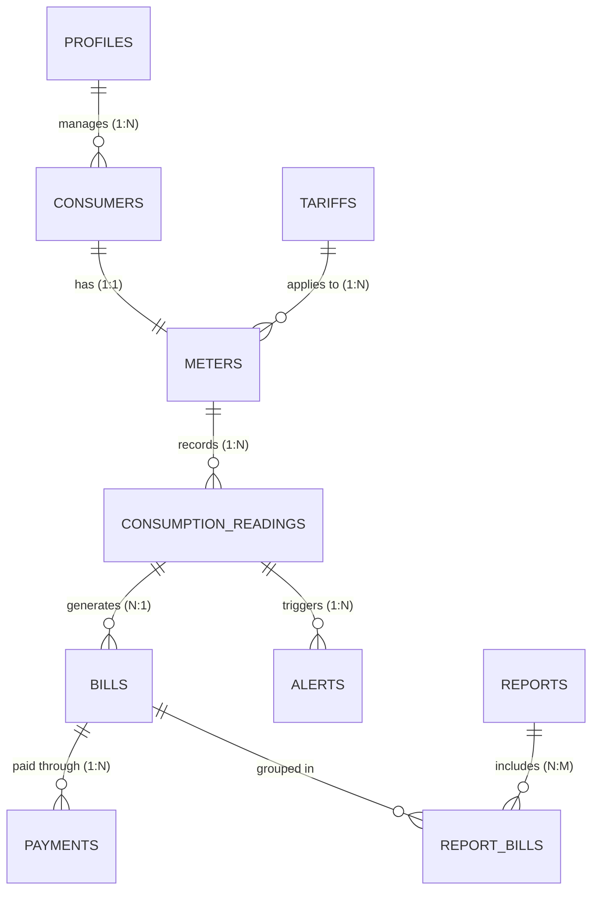

# Electricity Consumption Monitoring System (PowerGrid ECMS)
### Full-Stack Database Management System (DBMS) Micro Project

[](https://supabase.com)
[](https://nodejs.org)
[](https://vitejs.dev)
[](https://tailwindcss.com)
[]()

---

## 1. Problem Statement & Objective
Traditional electricity utility record-keeping often relies on manual meter logging, decentralized spreadsheets, or fragmented paperwork. These legacy workflows are prone to transcription errors, lack real-time visibility into abnormal consumption surges, complicate billing calculations across tiered tariffs, and delay payment reconciliation.

The **Electricity Consumption Monitoring System** is a centralized, database-driven web application engineered to replace manual operations with a normalized relational database architecture. The system supports:
- Consumer account lifecycle and address management.
- Electricity smart meter hardware assignments (strictly enforcing 1:1 consumer-to-meter relational integrity).
- Periodic cumulative meter reading entries with **derived unit calculations** ($\text{Units Consumed} = \text{Current} - \text{Previous}$) without redundant database storage.
- Dynamic **tariff-based billing** (Energy Charge + Fixed Charge + Tax Percentage).
- Transactional payment ledger supporting full and partial invoice settlements.
- Automated anomaly detection for **High Consumption Spikes** ($> 500\text{ kWh}$) and **Abnormal Usage Surges** ($\ge 50\%$).
- Daily, monthly, yearly, and consumer-wise regulatory reports with **CSV and PDF invoice exports**.
- **Role-Based Access Control (RBAC)** providing distinct experiences for Grid Administrators and Consumers, secured by PostgreSQL Row Level Security (RLS).

---

## 2. Technology Stack

### Frontend
- **Framework**: React 18 (JavaScript) + Vite
- **Routing**: React Router DOM v6
- **Styling**: Tailwind CSS (Energy-tech design language: emerald accents, slate dark navy, light neutral cards)
- **Charts & Telemetry**: Recharts (Responsive Area and Bar Charts)
- **Icons**: Lucide React
- **HTTP Client**: Axios with centralized request/response interceptors
- **Form Handling**: React Hook Form
- **Form Validation**: Zod schema validation (`@hookform/resolvers/zod`)

### Backend
- **Runtime**: Node.js (v18+)
- **Server Framework**: Express.js
- **Architecture**: RESTful API under `/api/v1`
- **Database Client**: `@supabase/supabase-js` with live Supabase client & in-memory demonstration store fallback
- **Security**: Helmet, CORS, Express-Rate-Limit
- **Validation**: Zod schema validation middleware
- **Reporting & Export**: PDFKit (printable utility invoices) & CSV formatting service
- **Testing**: Node.js built-in test runner (`node:test`, `node:assert`)

### Database
- **Engine**: Supabase PostgreSQL
- **Security**: Row Level Security (RLS) policies on all tables
- **Keys**: UUID primary keys and composite keys
- **Triggers & Functions**: PL/pgSQL stored procedures (`record_payment_transaction`, `fn_validate_consumption_reading`, `handle_new_user`)
- **Views**: Derived calculation view `v_consumption_readings`

---

## 3. Entity-Relationship (ER) Architecture

The application strictly implements the specifications from the provided ER Diagram and Project Report:



### Entity Mapping & Attributes

| Entity | PostgreSQL Table | Primary Key | Key Attributes | Relational Constraints |
| :--- | :--- | :--- | :--- | :--- |
| **User** | `profiles` | `id` (ref `auth.users`) | `username`, `role` (`admin`/`consumer`) | Role-based permissions, non-escalatable |
| **Tariff** | `tariffs` | `id` (UUID) | `name`, `rate_per_unit`, `fixed_charge`, `tax_percentage` | Non-negative CHECK constraints |
| **Consumer** | `consumers` | `id` (UUID) | `name`, `address`, `contact`, `user_id`, `consumer_user_id` | Ref `profiles(id)` via `user_id` (Manager Admin) |
| **Meter** | `meters` | `id` (UUID) | `meter_number` (UNIQUE), `meter_type`, `meter_status` | `consumer_id` UNIQUE (enforces 1:1 rule) |
| **Consumption** | `consumption_readings` | `(meter_id, reading_date)` | `previous_reading`, `current_reading` | **Composite PK**, `current >= previous` CHECK |
| **Bill** | `bills` | `id` (UUID) | `units_consumed`, `rate_per_unit`, `amount`, `due_date`, `payment_status` | **Composite FK** `(meter_id, reading_date)`, UNIQUE |
| **Payment** | `payments` | `id` (UUID) | `amount`, `payment_mode`, `payment_date`, `reference_number` | Ref `bills(id)`, amount $\le$ outstanding balance |
| **Alert** | `alerts` | `id` (UUID) | `alert_type`, `message`, `severity`, `is_read` | Composite FK `(meter_id, reading_date)` |
| **Report** | `reports` | `id` (UUID) | `report_type`, `filters`, `summary_data`, `report_date` | Multi-type aggregate analytics |

---

## 4. Key Business Logic & DBMS Integrity Rules

1. **Derived Consumption Units**:
   $$\text{Units Consumed} = \text{Current Cumulative Reading} - \text{Previous Cumulative Reading}$$
   Derived dynamically via `v_consumption_readings` and never stored redundantly.
2. **Chronological Consistency**: Database trigger `trg_validate_consumption` asserts that a new reading cannot be lower than the prior cumulative reading, nor higher than subsequent readings.
3. **Tariff Billing Breakdown**:
   - Energy Charge = $\text{Units Consumed} \times \text{Rate Per Unit}$
   - Subtotal = $\text{Energy Charge} + \text{Base Fixed Charge}$
   - Utility Tax = $(\text{Subtotal} \times \text{Tax Percentage}) / 100$
   - Total Amount = $\text{Subtotal} + \text{Utility Tax}$
   - Historical bills snapshot the applied tariff rates at the moment of billing, insulating past invoices from subsequent tariff changes.
4. **Transactional Payment Settlement**:
   Stored procedure `record_payment_transaction` utilizes `FOR UPDATE` row locking to prevent concurrent balance race conditions. It validates that the payment does not exceed the outstanding balance and atomically updates the bill status from `unpaid` $\rightarrow$ `partially_paid` $\rightarrow$ `paid`.
5. **Non-Destructive Deactivation**:
   To preserve financial audits and historical telemetry, accounts and meters utilize soft deactivation (`is_active = false`, `meter_status = 'inactive'`) rather than destructive `CASCADE` deletions.

---

## 5. Quick Start Guide

### Prerequisites
- Node.js 18+ (tested on Node v22.20.0)
- npm 9+

### Step 1: Clone and Install
```bash
git clone https://github.com/Pranav-496/Electricity-Consumption-Monitoring-System.git
cd Electricity-Consumption-Monitoring-System

# Install root, backend, and frontend packages with a single command
npm run install:all
```

### Step 2: Configure Environment Variables

**Backend (`server/.env`)**:
```env
PORT=5000
NODE_ENV=development
CLIENT_ORIGIN=http://localhost:5173

# Optional: Supabase PostgreSQL credentials (if connecting to live Supabase project)
SUPABASE_URL=https://your-project-id.supabase.co
SUPABASE_ANON_KEY=your_supabase_anon_public_key
SUPABASE_SERVICE_ROLE_KEY=your_server_only_service_role_key

# Standalone demo mode is enabled by default if Supabase keys are not yet input
ENABLE_DEMO_FALLBACK=true
```

**Frontend (`client/.env`)**:
```env
VITE_API_BASE_URL=http://localhost:5000/api/v1
VITE_SUPABASE_URL=https://your-project-id.supabase.co
VITE_SUPABASE_ANON_KEY=your_supabase_anon_public_key
```

### Step 3: Run Unit Tests
Verify all business rules, derived consumption calculations, tariff formulas, tax computations, and overpayment checks:
```bash
npm test
```
*Output: 9 tests passing across 5 suites.*

### Step 4: Start the Full-Stack Application
```bash
npm run dev
```
Both the backend REST API (`http://localhost:5000`) and the frontend Vite server (`http://localhost:5173`) will start concurrently.

---

## 6. Demonstration Credentials

The login screen provides **1-Click Quick Demo Buttons** for convenience:

| Role | Username / Email | Password | Access Rights |
| :--- | :--- | :--- | :--- |
| **Grid Administrator** | `admin@electric.local` | `Admin@12345` | Global dashboard, manage consumers, assign meters, configure tariffs, log readings, generate bills, record payments, trigger alert checks, export reports |
| **Consumer Portal** | `john.doe@example.com` | `Consumer@123` | Scoped personal dashboard, meter `MTR-2024-001`, personal consumption chart, personal invoices, payment receipts, personal alerts |

---

## 7. Supabase SQL Execution Order

When connecting to a live Supabase project, execute the SQL files in `database/` inside the **Supabase Dashboard -> SQL Editor** in the following order:

1. `database/schema.sql` (Creates tables, triggers, views, and functions)
2. `database/indexes.sql` (Creates query optimization indexes)
3. `database/rls_policies.sql` (Provisions Row Level Security access control)
4. `database/seed.sql` (Populates demonstration consumers, tariffs, meters, readings, bills, and payments)

---

## 8. REST API Endpoints Overview

| Method | Endpoint | Description | Access |
| :--- | :--- | :--- | :--- |
| `POST` | `/api/v1/auth/login` | Authenticate user session | Public |
| `POST` | `/api/v1/auth/register` | Register new consumer account | Public |
| `GET` | `/api/v1/auth/me` | Fetch authenticated profile & meters | Authenticated |
| `GET` | `/api/v1/dashboard/overview` | Fetch system KPI metrics | Authenticated |
| `GET` | `/api/v1/dashboard/consumption-trend`| Monthly consumption telemetry curve | Authenticated |
| `GET` | `/api/v1/dashboard/billing-summary` | Billed vs collected revenue trend | Authenticated |
| `GET` | `/api/v1/consumers` | List all consumers with search | Admin |
| `POST` | `/api/v1/consumers` | Register new consumer | Admin |
| `DELETE`| `/api/v1/consumers/:id` | Soft deactivation of consumer | Admin |
| `GET` | `/api/v1/meters` | List all meters | Admin |
| `POST` | `/api/v1/meters` | Assign meter (enforces 1:1 rule) | Admin |
| `GET` | `/api/v1/tariffs` | List all active tariff categories | Authenticated |
| `POST` | `/api/v1/tariffs` | Create tariff slab | Admin |
| `GET` | `/api/v1/consumption` | List chronological meter readings | Authenticated |
| `POST` | `/api/v1/consumption` | Record meter reading & evaluate alerts| Admin |
| `GET` | `/api/v1/bills` | List generated bills | Authenticated |
| `POST` | `/api/v1/bills/generate` | Generate bill from reading & tariff | Admin |
| `GET` | `/api/v1/bills/:id/download` | Download invoice PDF | Authenticated |
| `POST` | `/api/v1/payments` | Record payment transaction | Admin |
| `GET` | `/api/v1/alerts` | List threshold alerts & notices | Authenticated |
| `POST` | `/api/v1/alerts/check` | Evaluate surge & overdue alerts | Admin |
| `POST` | `/api/v1/reports/generate` | Generate tabular analytics report | Authenticated |
| `GET` | `/api/v1/reports/:type/download` | Export report to CSV | Authenticated |

---

## 9. Academic Project Documentation Directory
For deep-dive documentation on specific subsystems, consult the `docs/` folder:
- [Database Design & Normalization](file:///d:/Electricity-Consumption-Monitoring-System/docs/DATABASE_DESIGN.md)
- [REST API Specification](file:///d:/Electricity-Consumption-Monitoring-System/docs/API_DOCUMENTATION.md)
- [Business Rules & Calculation Formulas](file:///d:/Electricity-Consumption-Monitoring-System/docs/BUSINESS_RULES.md)
- [Setup & Demonstration Walkthrough](file:///d:/Electricity-Consumption-Monitoring-System/docs/SETUP_GUIDE.md)
- [Database SQL Scripts & Execution Guide](file:///d:/Electricity-Consumption-Monitoring-System/database/README.md)

---

## 10. Academic Scope & Limitations
- **Simulated Telemetry**: Meter readings are manually logged or generated via simulated telemetry inputs; this academic project does not connect to physical smart grid IoT hardware.
- **Payment Gateway Simulation**: Payment records represent verified ledger entries recorded by administrators/cashiers; no real banking transaction or credit card clearing gateway is simulated.